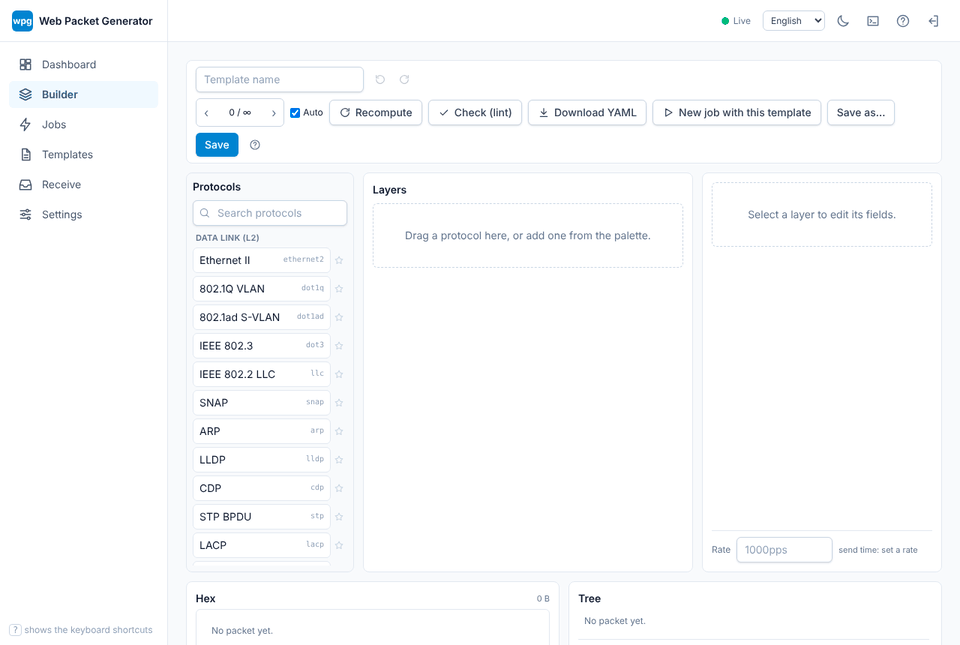

# wpg — web-packet-generator

**English** | [日本語](README.ja.md)

[](https://github.com/SeiyaFunaokaJP/web-packet-generator/actions/workflows/ci.yml)
[](https://github.com/SeiyaFunaokaJP/web-packet-generator/actions/workflows/audit.yml)
[](#license)

A high-performance, browser-driven packet generator for network verification, written entirely in Rust
(backend, packet engine and the WASM frontend). Build arbitrary packets in a GUI and send them at very
high rates to test network devices and topologies.

> **Status: pre-release (0.x).** Milestones M0 to M11 (engine, transmit and receive, server, GUI, templates,
> P0 to P2 protocols, deployment, documentation) are in place; the v1.0 release gate (M12) is in progress, and
> some paths (AF_XDP zero-copy and DPDK on physical NICs, CML2) are not yet verified on real hardware. See
> [TODO.md](TODO.md) for the roadmap and [CHANGELOG.md](CHANGELOG.md) for what has changed.

## What is wpg?

wpg lets network engineers, test engineers, lab users (CML2, EVE-NG, ...) and protocol implementers
assemble packets layer by layer in a web GUI, and transmit them with a fast backend. The binary is named
`wpg`; the web frontend is embedded in it, so a single executable is all you need.



What sets it apart:

1. **Deep protocol support**, including OSI-family protocols such as IS-IS and CLNP.
2. **Fast transmission** through AF_PACKET, AF_XDP and DPDK.
3. **GUI plus shareable templates**, so anyone can reproduce a test.

Non-goals for v1: a full capture/analysis tool (this is not a Wireshark replacement), stateful sessions
such as full TCP handshakes, and optimisation for attack tooling.

## Key features

- More than 180 protocols, from Ethernet, VLAN, IPv4/IPv6, TCP/UDP to routing (OSPF, BGP, IS-IS), OSI (CLNP, ES-IS),
  MPLS / SR / SRv6, tunnels, timing / OAM and application protocols ([protocol reference](docs/en/src/reference/protocols.md))
- Declarative protocol definitions that drive build, parse, GUI generation and documentation from one source
- Auto-computed lengths, checksums and next-header fields, with Auto/Manual toggles and deliberate malformed packets
- Field generators (range, list, random, counter, file, expr) and mass stream generation
- Instant in-browser preview: `wpg-core` is compiled to WASM and shared with the server
- YAML templates (`.wpg.yaml`) and bundles (`.wpgbundle`) for sharing; pcap/pcapng import
- Rate control (pps / bps / line-rate %), bursts, multi-queue / multi-core sending, live statistics over WebSocket
- Receive counters with tcpdump-style filters, signature-based loss / order / latency checks, pcapng capture
- REST API with OpenAPI, password authentication (argon2id), optional TLS
- Japanese and English UI, manuals and messages

## Quick start

Prerequisites: [rustup](https://rustup.rs), the WASM target
(`rustup target add wasm32-unknown-unknown`), [trunk](https://trunkrs.dev) (`cargo install trunk --locked`),
and optionally [just](https://github.com/casey/just). The libpcap / Npcap transmit backend is optional
(`cargo build --release --features pcap`, forwarded to `wpg-tx/pcap`): on Linux it needs `libpcap-dev`, macOS ships
libpcap, and on Windows it needs the Npcap runtime plus the [Npcap SDK](https://npcap.com/#download) (`wpcap.lib` on
`LIB`). Without the feature no pcap library is required. `wpg doctor` reports what is missing.

```sh
# Build (frontend, then backend)
just build            # or: ./scripts/build.sh      (Windows: .\scripts\build.ps1)
just release          # optimised build

# Run
./target/release/wpg serve    # or: ./scripts/run.sh   (Windows: .\scripts\run.ps1)
```

Then open <http://127.0.0.1:8080> in your browser.

For development with hot reload (needs `cargo install cargo-watch --locked`):

```sh
just run              # or: ./scripts/run.sh --dev
```

Raw-socket transmission needs privileges: on Linux run as root or use
`sudo setcap cap_net_raw,cap_net_admin+ep ./target/release/wpg`; on Windows install Npcap and run as
Administrator; on macOS grant access to `/dev/bpf*`. Run `wpg doctor` to diagnose.

## Architecture

```
┌──────────────────────────────────────────────────────────────┐
│ Browser (WASM: Leptos)                                       │
│  packet builder GUI, template manager, jobs, stats, i18n     │
└───────────────▲──────────────────────────────▲───────────────┘
                │ REST (JSON)                  │ WebSocket (stats/logs)
┌───────────────┴──────────────────────────────┴───────────────┐
│ wpg-server (axum + tokio) - single binary, embedded assets   │
│  auth, template CRUD, job management, OpenAPI                │
├──────────────────────────────────────────────────────────────┤
│ wpg-core (pure Rust, WASM-capable)                           │
│  protocol definition engine, build/parse, generators         │
├──────────────────────────────────────────────────────────────┤
│ wpg-tx (TxBackend trait)                                     │
│  pcap/Npcap | AF_PACKET | AF_XDP | DPDK | pcap file output   │
└──────────────────────────────────────────────────────────────┘
```

Workspace crates: `wpg-core`, `wpg-protocols`, `wpg-tx`, `wpg-rx`, `wpg-template`, `wpg-i18n`,
`wpg-server`, `wpg-cli` (binary `wpg`), `wpg-web`.

## Transmission backends

| Backend | OS | Expected performance | Notes |
|---|---|---|---|
| `pcap` (libpcap / Npcap / BPF) | Windows / macOS / Linux | up to several hundred kpps | Portable fallback |
| `afpacket` (TPACKET_V3 + `sendmmsg`) | Linux | ~1-3 Mpps/core | Main path on CML2 Ubuntu (virtio); needs CAP_NET_RAW |
| `afxdp` | Linux 5.10+ (`--features afxdp`) | several Mpps/core | Driver support for zero-copy; zero-copy/copy auto (zero-copy not yet verified on real NICs) |
| `dpdk` | Linux | 10 Mpps+/core | `--features dpdk`, DPDK 24.11 LTS (23.11 also); verified on virtual devices only |
| `pcapfile` | all | n/a | Writes pcapng instead of sending (dry run, CI) |
| `null` | all | n/a | Benchmarks and tests |

Minimum supported OS: Windows 10 21H2+, macOS 12+, Ubuntu 20.04+ (glibc 2.31). Windows transmission uses
Npcap only and is positioned as "GUI plus low-to-medium rate".

## Documentation

The user and developer manual is an mdBook in English ([`docs/en`](docs/en/src/SUMMARY.md)) and Japanese
([`docs/ja`](docs/ja/src/SUMMARY.md)): installation on the three OSes, tutorials, the generated protocol, CLI,
API and configuration references, operations (deployment, services, DPDK / AF_XDP, CML2, tuning) and the
developer guide. Build it with `just docs` (needs `cargo install mdbook --locked`).

## Roadmap

Milestones M0 to M12 and the full specification live in [TODO.md](TODO.md) (written in Japanese). Changes are
listed in [CHANGELOG.md](CHANGELOG.md).

## Legal notice and responsible use

wpg is a **network verification tool**. Use it **only on networks and devices you own or are explicitly
authorised to test**, such as isolated lab or test networks. Sending crafted or high-rate traffic to
production networks or third-party systems can disrupt services and may be illegal. It is not designed or
optimised for attacks. **You are solely responsible for how you use this software**; the authors and
contributors accept no liability for damage or misuse (see the disclaimer of warranty in the licences).

## Contributing

See [CONTRIBUTING.md](CONTRIBUTING.md) ([日本語](CONTRIBUTING.ja.md)) and the
[Code of Conduct](CODE_OF_CONDUCT.md).

## License

Licensed under either of

- Apache License, Version 2.0 ([LICENSE-APACHE](LICENSE-APACHE) or <http://www.apache.org/licenses/LICENSE-2.0>)
- MIT license ([LICENSE-MIT](LICENSE-MIT) or <http://opensource.org/licenses/MIT>)

at your option.

### Contribution

Unless you explicitly state otherwise, any contribution intentionally submitted for inclusion in the work
by you, as defined in the Apache-2.0 license, shall be dual licensed as above, without any additional terms
or conditions.
