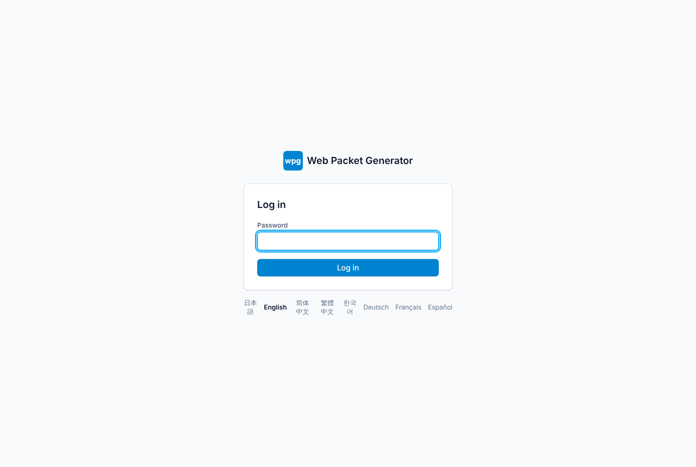
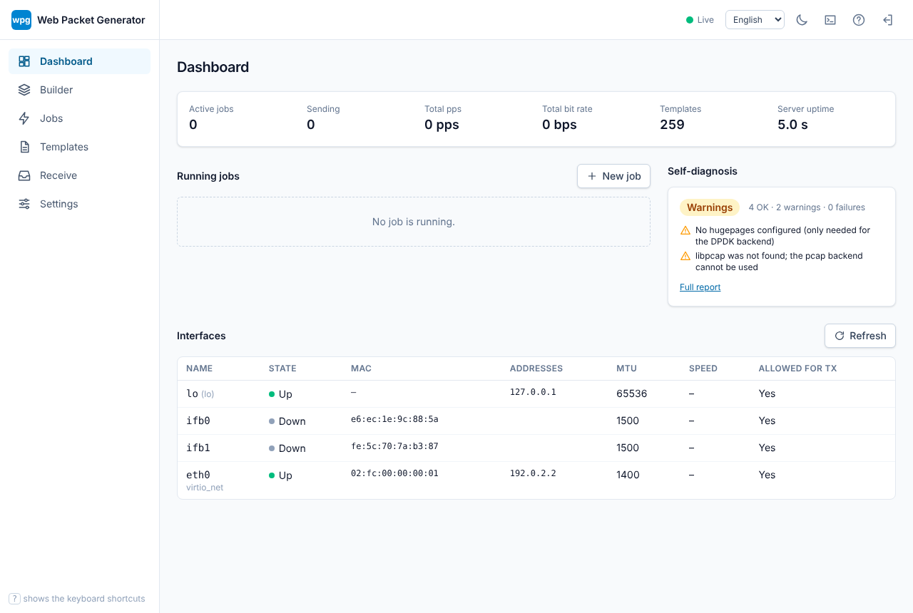
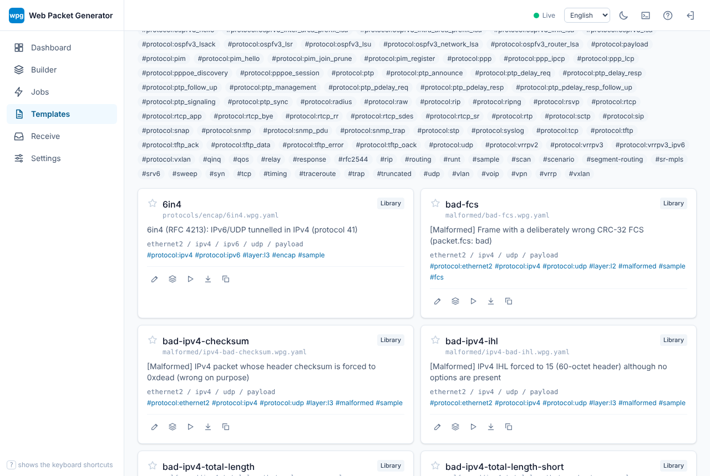
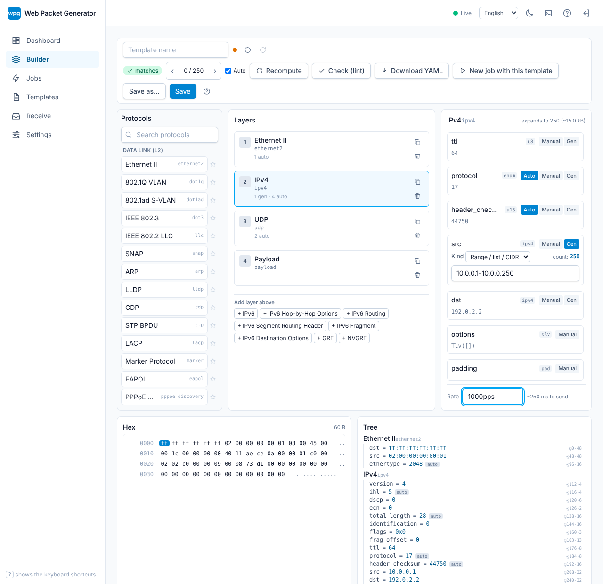
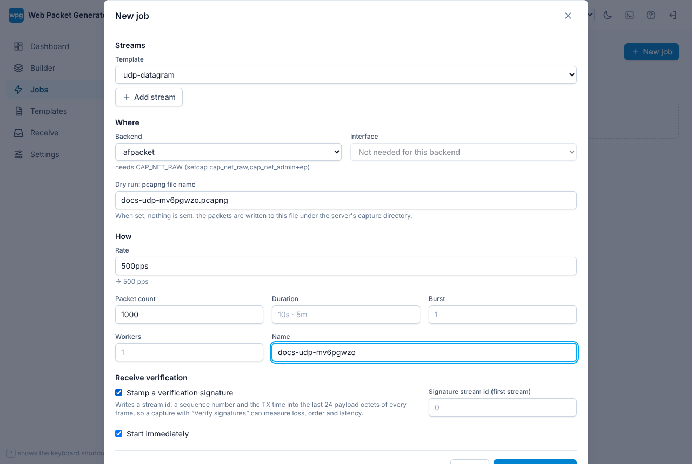
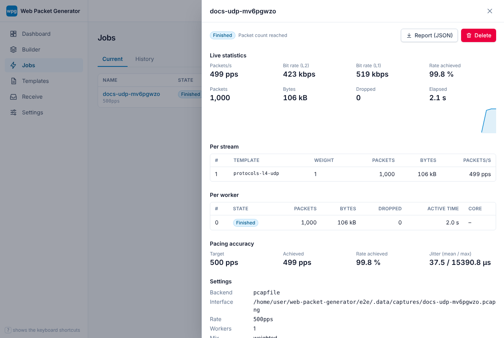

# First login

Start the server and open the address it prints:

```sh
wpg serve                       # listens on 127.0.0.1:8080
```

## Setting the administrator password

The password can come from any of these (highest priority first; run `wpg serve --help` to see which ones your build supports):

1. `wpg serve --password …` or `--password-file <file>`
2. the `WPG_PASSWORD` environment variable
3. `[auth] password_hash` / `password_file` in `wpg.toml` (an argon2id hash, written by `wpg config set-password`)
4. the setup screen shown on the first visit, if none of the above is set



While no password exists wpg accepts connections from the local machine only and warns at startup; do not bind it to a non-local address until a password is set. Passwords are stored as argon2id hashes, sessions use `HttpOnly`, `SameSite=Strict` cookies, and repeated failed logins are rate limited. For access over a network, put TLS in front (`--tls`, a certificate in `wpg.toml`, or a reverse proxy).

## The first screens

After logging in you land on the dashboard: interface state, running jobs and recent statistics. Then:

1. **Templates**: the bundled library (`examples`, `protocols`, `scenarios`, `malformed`) is listed here, searchable by tag (`protocol:ipv4`, `layer:l3`, `scenario`, `malformed`). Open one, or duplicate it to make your own.
2. **Builder**: stack layers, edit fields (Auto/Manual, generators) and watch the hex dump and field tree update.
3. **Jobs**: pick templates, an interface, a rate and a count, and start. A dry run writes a pcapng instead of sending.
4. **Settings**: language (Japanese, English, Simplified Chinese, Traditional Chinese, Korean, German, French, Spanish), theme, template library paths.











The language menu and the theme toggle are in the header of every screen.

If sending is refused, run `wpg doctor` and read [Permissions](permissions.md). Then work through the [ARP sweep tutorial](../tutorials/arp-sweep.md).
