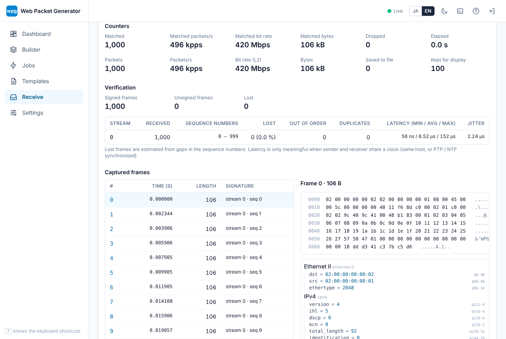

# Receive and verification

Status: draft

Besides sending, wpg can do simple receive-side checks (v1 is deliberately minimal):

- receive counters: frames, bytes, pps / bps received, and the count and rate of frames matching a filter;
- matching with a tcpdump-style filter expression;
- the first N frames (hex and decoded);
- saving the matching frames as pcapng;
- loss, reordering, duplicates and latency estimates from signatures embedded by the sender.

The CLI is [`wpg capture`](../reference/cli.md#wpg-capture), the web UI has a "Receive" page and the API is [`/api/captures`](../reference/api.md).

## Receive backends

| Backend | OS | Notes |
|---|---|---|
| `afpacket` | Linux | Receives through an `AF_PACKET` raw socket; `-i any` means every interface. Needs `CAP_NET_RAW` ([Permissions](../getting-started/permissions.md)). Frames this host transmits (`PACKET_OUTGOING`) are not counted by default, so a frame sent and received on `lo` counts once; `--include-outgoing` counts them too. Kernel drops (`PACKET_STATISTICS`) are shown as `dropped`. |
| `pcap` | all | libpcap / Npcap, only in builds with `--features pcap`. Excluding outgoing frames (`pcap_setdirection`) does not work on Windows. |
| `pcapfile` | all | Replays a pcap / pcapng file as if its frames had just been received, with their recorded timestamps. Give the file path instead of an interface. Useful without a NIC and for offline verification of a capture taken elsewhere. Replay is instant, so pps / bps are processing speeds. |
| `null` | all | Receives nothing (tests). |

## Filters

Filters are a subset of tcpdump / BPF, evaluated in user space the same way on every backend. An empty filter matches every frame. Keywords are case-insensitive.

| Syntax | Meaning |
|---|---|
| `and` / `&&`, `or` / `\|\|`, `not` / `!`, `( )` | Logic (precedence not > and > or) |
| `ether [src\|dst] host <MAC>`, `ether src <MAC>` | Source / destination MAC (`00:11:22:33:44:55`, `0011.2233.4455`) |
| `ether proto <number\|ip\|ip6\|arp\|vlan\|mpls\|lldp\|pppoe>` | EtherType (tag types count too) |
| `broadcast`, `multicast` (optionally after `ether`) | All-ones / multicast destination MAC |
| `vlan [<id>]` | Has an 802.1Q / 802.1ad tag (with an id: any tag with that id) |
| `mpls` | MPLS (0x8847 / 0x8848) |
| `ip`, `ip6`, `arp`, `rarp` | L3 type |
| `tcp`, `udp`, `sctp`, `icmp`, `icmp6` | Transport type |
| `ip proto <number\|name>`, `ip6 proto …`, `proto …` | IP protocol number (names such as `ospf`, `gre`, `pim`, `vrrp` work too) |
| `[src\|dst] host <address>`, `src <address>` | IPv4 / IPv6 address (also ARP sender / target addresses) |
| `[src\|dst] net <address/len>`, `net <address> mask <mask>` | Network |
| `[tcp\|udp\|sctp] [src\|dst] port <n>` | Port |
| `[tcp\|udp\|sctp] [src\|dst] portrange <low>-<high>` | Port range |
| `less <n>`, `greater <n>`, `len <\|<=\|>\|>=\|==\|!= <n>` | Frame length (without FCS) |
| `wpg` (`signature`) | Frames carrying a wpg signature |

Examples: `udp dst port 5001 and wpg`, `vlan 100 and not arp`, `ip6 and net 2001:db8::/32`.

Differences from tcpdump:

- `vlan` does not shift the offsets of later primitives; every primitive looks inside the VLAN tags.
- `host` / `net` also match ARP addresses.
- Byte-offset expressions such as `ip[0] & 0xf` are not supported.
- Matching happens in user space, so every received frame is copied to user space.

Syntax errors are reported with their position (`wpg capture` exits with status 2, the API answers 400, the web UI shows the error at the input).

## Signatures

With `wpg send --signature` (job option `"signature": true`, the checkbox on the web UI's job page) every frame gets a signature written over its **last 24 octets**:

| Offset | Size | Content |
|---:|---:|---|
| 0 | 4 | magic `57 50 47 01` (`"WPG"` + version 1) |
| 4 | 4 | stream id (big endian) |
| 8 | 8 | sequence number within the stream (from 0) |
| 16 | 8 | TX time (nanoseconds since the Unix epoch) |

- Only payload (or Ethernet padding) is overwritten. The sender reads the Ethernet / 802.1Q / 802.1ad / IPv4 / IPv6 (extension headers) / UDP / TCP / ICMP / ICMPv6 headers; a frame with fewer than 24 octets after them is sent unchanged and counted as `unsigned` in the statistics. Give the template a payload of at least 24 octets when using signatures.
- UDP / TCP / ICMP / ICMPv6 checksums are updated incrementally (RFC 1624), so receivers do not see bad checksums. An IPv4 UDP checksum of 0 (not computed) stays 0. Other checksums (OSPF, GRE, …) are not updated.
- The stream id is `--stream-id` (default 0) plus the stream index; the streams of a mixed job get distinct ids.
- Sequence numbers count per stream from 0 across all workers. The TX time is taken once per batch.

The receiver looks for the magic within the last 92 octets of a frame, so Ethernet padding or an FCS added on the way do not hide it.

## Reading the verification results

With `--verify` (`verify` in the API / web UI) the signatures of the matching frames are aggregated per stream:

| Field | Meaning |
|---|---|
| received | Frames received with that stream id |
| seq first–last | Lowest / highest sequence number received |
| lost | `(highest − lowest + 1) − distinct sequence numbers received`. An estimate: frames before the lowest one (sent before the capture started) and frames still in flight at the time of the snapshot are not counted. |
| reordered | Frames that arrived after a higher sequence number |
| duplicates | Sequence numbers received twice within the last 65536 sequence numbers (older repeats count as reordered) |
| latency min / avg / max | Receive time − TX time |
| jitter | Mean absolute difference between consecutive latencies |

Latency is only meaningful when sender and receiver share a clock (same host, or hosts synchronised with PTP / NTP); negative values mean the clocks disagree. It includes the kernel network stack and batching.

## Examples

### Same host over `lo` (Linux)

```sh
# terminal 1: receive (ends after 1000 frames)
wpg capture -i lo -f "udp port 5001 and wpg" --count 1000 --verify -w rx.pcapng
# terminal 2: send
wpg send templates/examples/eth-ipv4-udp-range.wpg.yaml -i lo --backend afpacket \
  --count 1000 --rate 50kpps --signature --stream-id 9
```

Receiver output:

```text
#   0  12:54:03.823537753    106 B  ethernet2 / ipv4 / udp / raw  [wpg stream 9 seq 0]
...
matched    1000 pkts  106000 bytes
saved      1000 pkts to rx.pcapng
signed     1000 with a signature, 0 without
stream 9     received 1000  seq 0-999  lost 0 (0.000%)  reordered 0  duplicates 0
             latency min 96.4 µs  avg 190.5 µs  max 829.9 µs  jitter 5.6 µs
```

### Two hosts

Start `wpg capture -i eth1 --verify -f "udp and wpg"` on the receiver first, then `wpg send … --signature` on the sender. For latency, synchronise both clocks (PTP, …); loss and ordering do not need synchronised clocks.

### Without a NIC (every OS)

```sh
wpg send templates/examples/eth-ipv4-udp-range.wpg.yaml --backend pcapfile -i tx.pcapng \
  --count 500 --signature
wpg capture --backend pcapfile -i tx.pcapng --verify
```

A capture taken elsewhere (a switch mirror port, …) can be verified offline the same way.

## Web UI

On the "Receive" page choose the backend, interface, filter (checked while you type), packet / time limits, how many leading frames to keep, a file name to save to and whether to verify signatures, then start. While it runs, counters and rates update live over the WebSocket, with the per-stream verification results and the list of the first N frames (hex and decoded view of the selected one). A saved pcapng file can be downloaded once the capture has ended.



For the `pcapfile` backend the input file and the save file are file names under `captures/` in the server's data directory (where job dry runs are written too).

## Limitations

- Filters are evaluated in user space and `afpacket` calls `recvfrom` once per frame, so receiving more than a few hundred thousand pps is out of scope; at high rates compare the receive counters with NIC or switch statistics.
- Saved pcapng files have microsecond timestamps.
- Full capture features (ring buffers, file rotation, kernel BPF) are out of scope.
