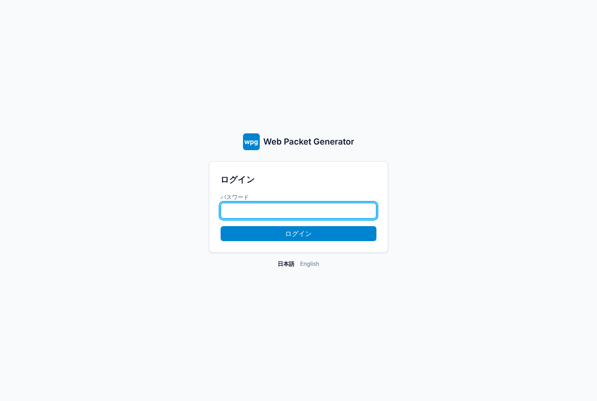
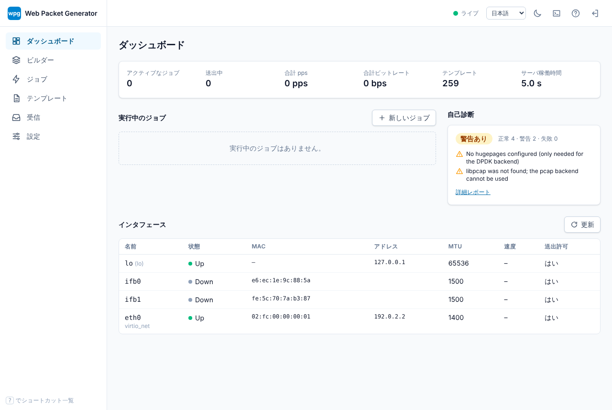
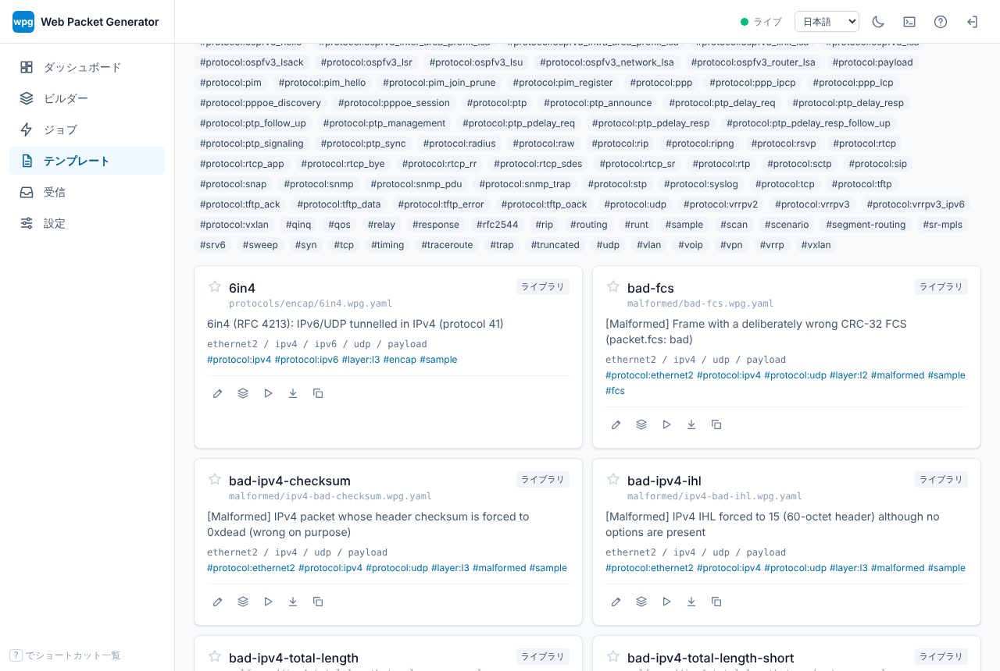
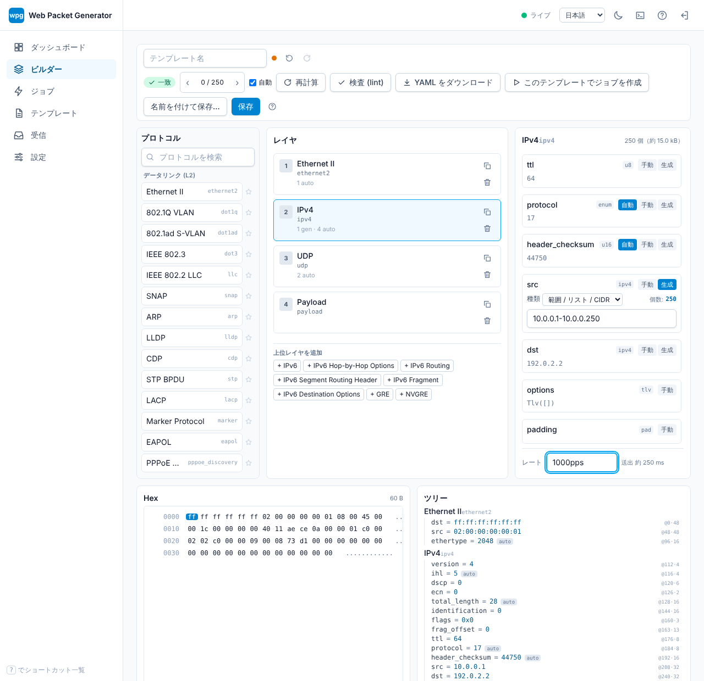
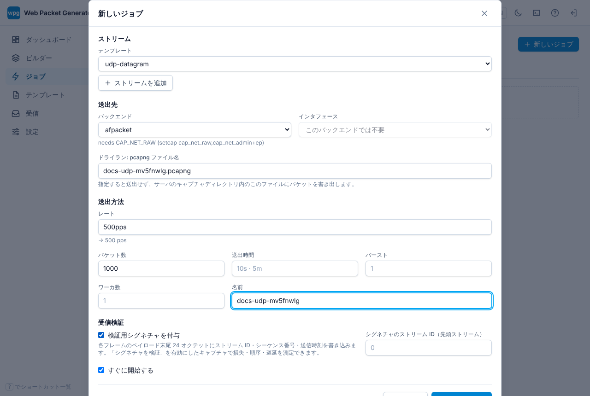
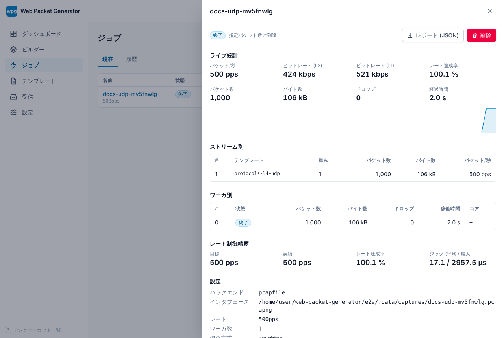

# 初回ログイン

サーバを起動し、表示されたアドレスを開きます。

```sh
wpg serve                       # 127.0.0.1:8080 で待ち受け
```

## 管理パスワードの設定

パスワードは次のいずれかで設定します (優先度の高い順。お使いのビルドが対応するものは `wpg serve --help` で確認してください)。

1. `wpg serve --password …` または `--password-file <file>`
2. 環境変数 `WPG_PASSWORD`
3. `wpg.toml` の `[auth] password_hash` / `password_file` (argon2id ハッシュ。`wpg config set-password` で書き込み)
4. 上のいずれも無い場合の、初回アクセス時のセットアップ画面



パスワードが無い間、wpg はローカルマシンからの接続だけを受け付け、起動時に警告します。パスワードを設定するまでは、ローカル以外のアドレスに bind しないでください。パスワードは argon2id ハッシュで保存され、セッションは `HttpOnly`、`SameSite=Strict` の Cookie で管理され、ログイン失敗の繰り返しはレート制限されます。ネットワーク越しにアクセスするときは TLS を前段に置きます (`--tls`、`wpg.toml` の証明書、またはリバースプロキシ)。

## 最初の画面

ログインするとダッシュボードが開きます。インタフェース状態、実行中ジョブ、直近の統計が見られます。続いて次の画面を使います。

1. **テンプレート**: 同梱ライブラリ (`examples`、`protocols`、`scenarios`、`malformed`) が一覧され、タグ (`protocol:ipv4`、`layer:l3`、`scenario`、`malformed`) で検索できます。開くか、複製して自分用にします。
2. **ビルダー**: レイヤを積み、フィールド (Auto/Manual、ジェネレータ) を編集し、Hex ダンプとフィールドツリーの更新を確認します。空のビルダーには「Ethernet II / IPv4 / UDP」などのよく使う構成が並び、各フィールドには既定値 (MAC アドレス、IP アドレスなど) が入った入力欄が最初から表示されます。入力するとその値が手動の値になり、↺ で既定値に戻ります。
   - 既定では規格どおりのパケットだけを作れます。長さ・チェックサムなどの自動計算フィールドは固定され、規格外の値 (長さやチェックサムの不一致、制約外の値など) はフィールドの下とツールバーにエラーとして表示され、保存とジョブ作成ができません。
   - 異常系のパケットを作るときは、ツールバーの **イレギュラーを許可** をオンにします。自動計算フィールドを「上書き」でき、規格外の値は警告として扱われます。設定はブラウザごとに保存され、規格外の値を含むテンプレート (`malformed` など) を開くと自動でオンになります。
3. **ジョブ**: テンプレート、インタフェース、レート、回数を選んで開始します。ドライランは送信せず pcapng を書き出します。
4. **設定**: 言語 (日本語・英語・中国語簡体字・中国語繁体字・韓国語・ドイツ語・フランス語・スペイン語)、テーマ、テンプレートのライブラリパス。











言語の切り替え (ヘッダの言語メニュー) とテーマの切り替えは、どの画面でもヘッダにあります。

送信が拒否されたら `wpg doctor` を実行し、[権限設定](permissions.md) を読んでください。その後 [ARP スイープのチュートリアル](../tutorials/arp-sweep.md) に進みます。
