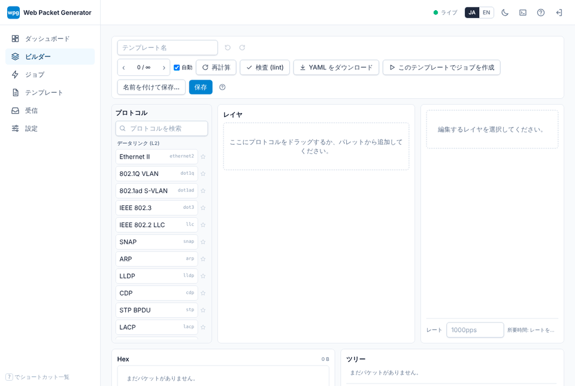

# はじめに

wpg (web-packet-generator) は、Web GUI で動作するネットワーク検証向けの Rust 製パケットジェネレータです。IS-IS や CLNP など OSI 系の深いプロトコルまで含め、任意のパケットを組み立てて高速に送出できます。送出バックエンドは pcap/Npcap から AF_PACKET、AF_XDP、DPDK まで選択可能です。Windows / macOS / Linux 向けの単一バイナリとして配布されます。利用は検証環境に限定してください。

## どこから読むか

1. [インストール方法を選ぶ](getting-started/overview.md): 手元の OS でソースからビルドする、SSH で Linux の検証ホストにデプロイする、Docker イメージで動かす、のいずれかを選びます。
2. 選んだ方法のインストールページに沿って進めます。`wpg doctor` が送信できないと報告したら [権限設定](getting-started/permissions.md) を読みます。
3. [初回ログイン](getting-started/first-login.md): パスワードを設定し、画面をひととおり見ます。
4. チュートリアルを [ARP スイープ](tutorials/arp-sweep.md) から順に進めます。

送信以外は権限なしで試せます。テンプレートを pcapng ファイルに書き出すだけなら raw ソケットは不要です。

## 用語

| 用語 | 意味 |
|---|---|
| テンプレート | パケットをレイヤ (`ethernet2`、`ipv4`、`udp` など) の積み重ねとして記述する `.wpg.yaml` ファイル。フィールドの値、変数、ジェネレータを含みます。保存・共有・送信の単位です。[テンプレートスキーマ](reference/template-schema.md) を参照。 |
| ライブラリ | wpg が読み込むテンプレートのディレクトリ。既定は `./templates` です。同梱ライブラリには `examples`、`protocols`、`scenarios`、`malformed`、`interop` があります。 |
| フィールドジェネレータ | フレームごとに変わるフィールドの値。範囲、リスト、乱数、カウンタ、ファイルからの値、式があります。1 つのテンプレートから多数のフレーム (ストリーム) を生成できます。 |
| ビルダー | テンプレートをレイヤ単位で編集し、16 進ダンプとフィールドツリーをブラウザ上でプレビューする GUI 画面。 |
| ジョブ | テンプレートを、あるインタフェースから、レート (pps、bps、回線速度の %) と個数または時間を指定して送る 1 回の実行。統計がリアルタイムに表示されます。 |
| バックエンド | フレームの送り出し方。Linux では `afpacket`、`afxdp`、`dpdk`、全 OS で `pcap` (libpcap / Npcap / BPF)、送らずに pcapng に書き出す `pcapfile` (ドライラン)、ベンチマーク用の `null` があります。 |
| `wpg doctor` | 権限、インタフェース、カーネル機能、ライブラリを確認する自己診断。失敗した項目ごとに対処方法を表示します。 |

同じバイナリがサーバ (`wpg serve`: Web UI と REST API) とコマンドラインツール (`wpg send`、`wpg render`、`wpg template lint` など) を兼ねます。[CLI リファレンス](reference/cli.md) を参照してください。

## このマニュアルの構成

- **はじめに (Getting Started)**: インストール、権限設定、初回ログイン。
- **チュートリアル**: ARP スイープ、レート制御、pcap の再生、IS-IS の隣接確立などを最初から最後まで行う手順。
- **リファレンス**: 全プロトコル、テンプレートスキーマ、API、CLI、`wpg.toml` の生成ページ。
- **運用**: デプロイ、サービス化、Docker、アップグレード、高速バックエンド、TLS、受信と検証。
- **開発者ガイド**: crate 構成、プロトコルと翻訳の追加手順。

送信は、自分が管理しているか試験を許可されたネットワークでだけ行ってください。[法的注意](legal.md) を参照してください。
