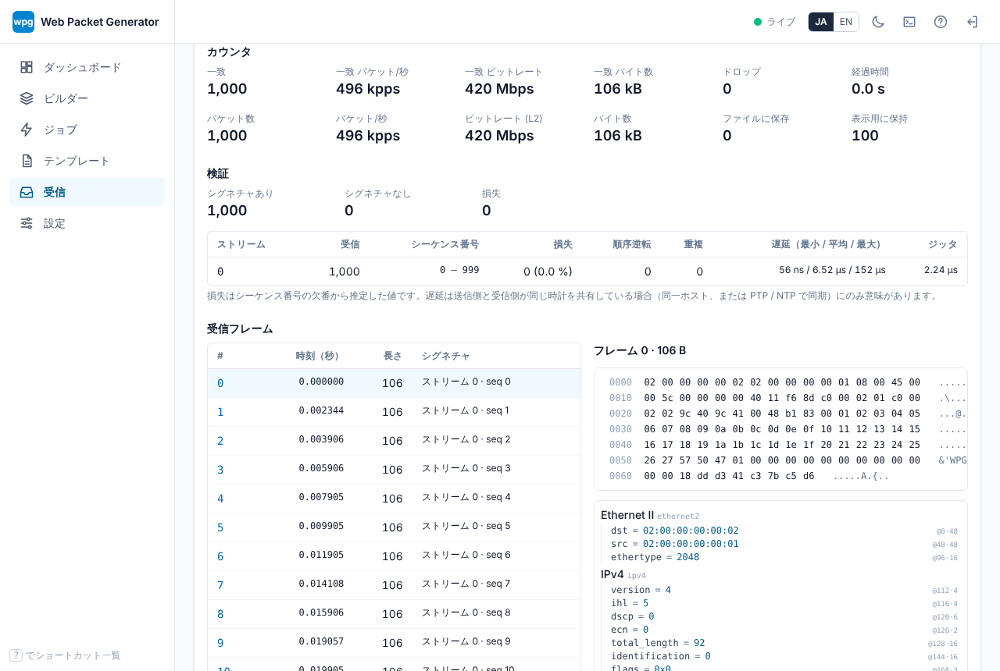

# 受信と検証

Status: draft

wpg は送出だけでなく、受信側の簡単な確認もできます (v1 は最小構成です)。

- 受信カウンタ: 受信フレーム数・バイト数・pps / bps と、フィルタに一致したフレームの数とレート
- tcpdump 風のフィルタ式による一致判定
- 最初の N フレームの表示 (Hex とデコード結果)
- 一致したフレームの pcapng 保存
- 送出時に埋め込んだシグネチャの照合による、ロス・順序逆転・重複・遅延の概算

CLI は [`wpg capture`](../reference/cli.md#wpg-capture)、Web UI は「受信」画面、API は [`/api/captures`](../reference/api.md) です。

## 受信バックエンド

| バックエンド | OS | 内容 |
|---|---|---|
| `afpacket` | Linux | `AF_PACKET` raw ソケットで受信します。`-i any` で全インタフェース。`CAP_NET_RAW` が必要です ([権限設定](../getting-started/permissions.md))。自ホストが送出したフレーム (`PACKET_OUTGOING`) は既定で数えないため、`lo` で送受信しても 1 フレームは 1 回だけ数えられます。`--include-outgoing` で送出側も数えます。カーネルでのドロップ数 (`PACKET_STATISTICS`) を `dropped` に表示します。 |
| `pcap` | 全 OS | libpcap / Npcap。`--features pcap` でビルドしたときのみ使えます。送出フレームの除外 (`pcap_setdirection`) は Windows では効きません。 |
| `pcapfile` | 全 OS | pcap / pcapng ファイルを、記録時刻のまま受信したものとして再生します。インタフェースの代わりにファイルパスを指定します。実機 NIC なしの確認や、別の場所で取ったキャプチャのオフライン照合に使います。再生は一瞬で終わるため、pps / bps は「処理速度」になります。 |
| `null` | 全 OS | 何も受信しません (テスト用)。 |

## フィルタ

フィルタは tcpdump / BPF の一部を、バックエンドに関係なくユーザ空間で評価します。空のフィルタは全フレームに一致します。キーワードは大文字小文字を区別しません。

| 書き方 | 意味 |
|---|---|
| `and` / `&&`、`or` / `\|\|`、`not` / `!`、`( )` | 論理演算 (優先順位は not > and > or) |
| `ether [src\|dst] host <MAC>`、`ether src <MAC>` | 送信元 / 宛先 MAC (`00:11:22:33:44:55`、`0011.2233.4455`) |
| `ether proto <番号\|ip\|ip6\|arp\|vlan\|mpls\|lldp\|pppoe>` | EtherType (VLAN タグの種別も含めて判定) |
| `broadcast`、`multicast` (`ether` を前に付けても可) | 宛先 MAC が全 1 / マルチキャスト |
| `vlan [<ID>]` | 802.1Q / 802.1ad タグがある (ID 指定時はいずれかのタグがその ID) |
| `mpls` | MPLS (0x8847 / 0x8848) |
| `ip`、`ip6`、`arp`、`rarp` | L3 の種別 |
| `tcp`、`udp`、`sctp`、`icmp`、`icmp6` | トランスポートの種別 |
| `ip proto <番号\|名前>`、`ip6 proto …`、`proto …` | IP プロトコル番号 (`ospf`、`gre`、`pim`、`vrrp` などの名前も可) |
| `[src\|dst] host <アドレス>`、`src <アドレス>` | IPv4 / IPv6 アドレス (ARP の送信元 / 対象アドレスも対象) |
| `[src\|dst] net <アドレス/長さ>`、`net <アドレス> mask <マスク>` | ネットワーク |
| `[tcp\|udp\|sctp] [src\|dst] port <番号>` | ポート |
| `[tcp\|udp\|sctp] [src\|dst] portrange <下限>-<上限>` | ポート範囲 |
| `less <n>`、`greater <n>`、`len <\|<=\|>\|>=\|==\|!= <n>` | フレーム長 (FCS なし) |
| `wpg` (`signature`) | wpg のシグネチャを含むフレーム |

例: `udp dst port 5001 and wpg`、`vlan 100 and not arp`、`ip6 and net 2001:db8::/32`。

tcpdump との違い:

- `vlan` の後ろでもオフセットはずれません。どのプリミティブも VLAN タグの内側を見ます。
- `host` / `net` は ARP のアドレスにも一致します。
- `ip[0] & 0xf` のようなバイトオフセット式はありません。
- 判定はユーザ空間で行うため、受信した全フレームがユーザ空間にコピーされます。

文法エラーは位置付きで報告されます (`wpg capture` は終了コード 2、API は 400、Web UI は入力欄に表示)。

## シグネチャ

`wpg send --signature` (ジョブでは `"signature": true`、Web UI のジョブ画面のチェックボックス) を指定すると、送出する各フレームの **末尾 24 オクテット** にシグネチャを書き込みます。

| オフセット | 長さ | 内容 |
|---:|---:|---|
| 0 | 4 | magic `57 50 47 01` (`"WPG"` + 版 1) |
| 4 | 4 | ストリーム ID (ビッグエンディアン) |
| 8 | 8 | ストリーム内の連番 (0 から) |
| 16 | 8 | 送出時刻 (Unix エポックからのナノ秒) |

- 上書きするのはペイロード (または Ethernet のパディング) だけです。Ethernet / 802.1Q / 802.1ad / IPv4 / IPv6 (拡張ヘッダ) / UDP / TCP / ICMP / ICMPv6 のヘッダを読み、その後ろに 24 オクテット以上ないフレームはそのまま送り、統計の `unsigned` (CLI の「未署名」) に数えます。シグネチャを使うときは、ペイロードを 24 オクテット以上にしてください。
- UDP / TCP / ICMP / ICMPv6 のチェックサムは差分更新 (RFC 1624) するので、受信側で不正なチェックサムにはなりません。IPv4 の UDP チェックサムが 0 (未計算) の場合は 0 のままです。OSPF や GRE のチェックサムなど、それ以外のチェックサムは更新しません。
- ストリーム ID は `--stream-id` (既定 0) + ストリーム番号です。複数ストリームのジョブでは、ストリームごとに別の ID になります。
- 連番はストリームごとに、全ワーカーを通して 0 から振られます。送出時刻はバッチ単位で取ります。

受信側はフレームの末尾 92 オクテット以内で magic を探すため、受信時に付いた Ethernet パディングや FCS があっても見つけられます。

## 照合結果の読み方

`--verify` (API / Web UI では `verify`) を付けると、フィルタに一致したフレームのシグネチャをストリームごとに集計します。

| 項目 | 意味 |
|---|---|
| received | そのストリーム ID で受信したフレーム数 |
| seq first–last | 受信した最小・最大の連番 |
| lost | `(最大 − 最小 + 1) − 受信した連番の種類数`。概算です。最小より前 (受信開始前に送られた分) と、集計時点でまだ届いていないフレームは数えません。 |
| reordered | それより大きい連番の後に届いたフレーム |
| duplicates | 直近 65536 連番以内で 2 回目に届いた連番 (それより古い重複は reordered に数えます) |
| latency min / avg / max | 受信時刻 − 送出時刻 |
| jitter | 連続するフレームの遅延の差の絶対値の平均 |

遅延は送信側と受信側の時計が一致している場合だけ意味があります (同一ホスト、または PTP / NTP で同期したホスト)。負の値は時計がずれていることを示します。遅延にはカーネルのネットワークスタックとバッチ処理の時間も含まれます。

## 例

### 同一ホストの `lo` で試す (Linux)

```sh
# 端末 1: 受信 (1000 フレーム受けたら終了)
wpg capture -i lo -f "udp port 5001 and wpg" --count 1000 --verify -w rx.pcapng
# 端末 2: 送出
wpg send templates/examples/eth-ipv4-udp-range.wpg.yaml -i lo --backend afpacket \
  --count 1000 --rate 50kpps --signature --stream-id 9
```

受信側の出力例:

```text
#   0  12:54:03.823537753    106 B  ethernet2 / ipv4 / udp / raw  [wpg stream 9 seq 0]
...
matched    1000 pkts  106000 bytes
saved      1000 pkts to rx.pcapng
signed     1000 with a signature, 0 without
stream 9     received 1000  seq 0-999  lost 0 (0.000%)  reordered 0  duplicates 0
             latency min 96.4 µs  avg 190.5 µs  max 829.9 µs  jitter 5.6 µs
```

### 2 台のホストで試す

受信側で `wpg capture -i eth1 --verify -f "udp and wpg"` を先に起動し、送信側で `wpg send … --signature` を実行します。遅延を見る場合は両ホストの時計を PTP などで同期してください。ロスと順序の確認には時計の同期は不要です。

### NIC なしで試す (全 OS)

```sh
wpg send templates/examples/eth-ipv4-udp-range.wpg.yaml --backend pcapfile -i tx.pcapng \
  --count 500 --signature
wpg capture --backend pcapfile -i tx.pcapng --verify
```

別の場所 (スイッチのミラーポートなど) で取ったキャプチャも、同じ方法でオフライン照合できます。

## Web UI

「受信」画面でバックエンド、インタフェース、フィルタ (入力中に検査されます)、件数・時間の上限、表示する先頭フレーム数、保存ファイル名、シグネチャ照合の有無を指定して開始します。実行中はカウンタとレートが WebSocket でリアルタイムに更新され、ストリームごとの照合結果、先頭 N フレームの一覧 (選んだフレームの Hex とデコード結果) を表示します。保存した pcapng は終了後にダウンロードできます。



`pcapfile` バックエンドのファイルと保存先は、サーバのデータディレクトリの `captures/` 以下のファイル名で指定します (ジョブのドライラン出力もここに書かれます)。

## 制約

- フィルタはユーザ空間で評価し、`afpacket` は 1 フレームごとに `recvfrom` を呼ぶため、数十万 pps を超える受信には向きません。高レートの計測では、受信カウンタを NIC やスイッチの統計と併用してください。
- 保存する pcapng のタイムスタンプはマイクロ秒単位です。
- 本格的なキャプチャ機能 (リングバッファ、ファイル分割、カーネル BPF) は対象外です。
